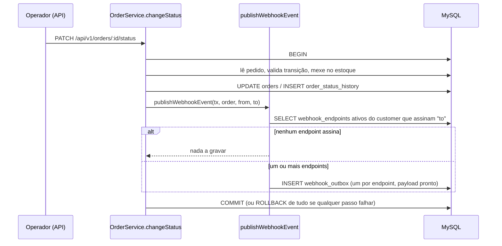
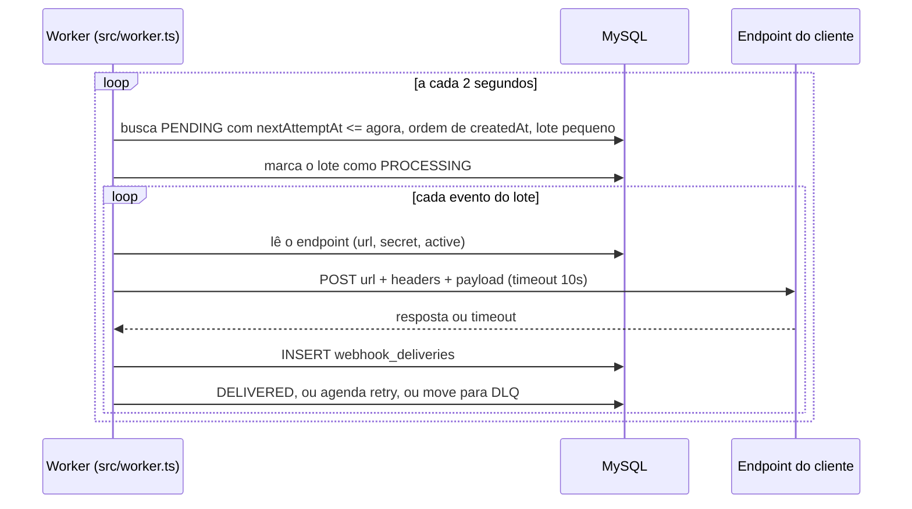
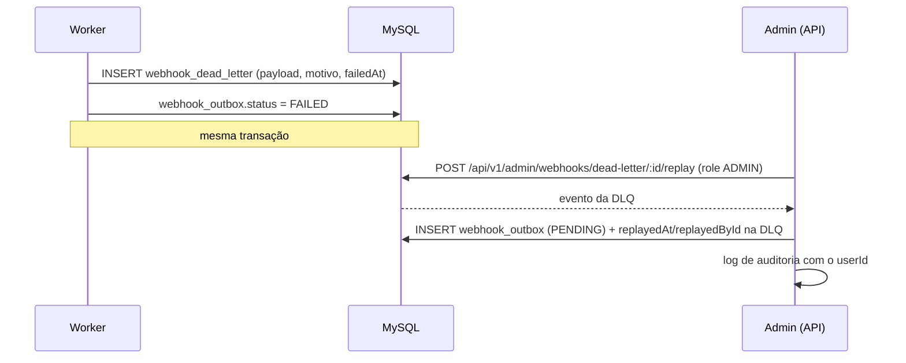

# FDD — Webhooks de notificação de mudança de status de pedido

| Campo | Valor |
| --- | --- |
| Autor | Leticiasg |
| Status | Rascunho para revisão |
| Data | 2026-11-25 |
| Documentos ligados | [PRD](PRD.md) · [RFC](RFC.md) · [ADRs](adrs/) · [Tracker](TRACKER.md) |

Este documento detalha como construir a feature proposta no [RFC](RFC.md). As decisões e seus porquês estão nos ADRs; aqui ficam os fluxos, os contratos, os erros e os pontos exatos do código que mudam. O que a reunião não decidiu e a implementação precisa saber está reunido em [Pendências para a revisão](#pendências-para-a-revisão), com ids P-01 a P-11 citados ao longo do texto.

Convenção de fontes: falas da reunião aparecem como `[hh:mm] Nome`; arquivos do código, pelo caminho. Nomes de tabelas, colunas e rotas que a reunião não fixou são propostas deste FDD e vêm marcados como tal.

## Contexto e motivação técnica

O OMS não tem nenhum mecanismo de evento, fila ou chamada para sistemas externos. A única forma de um cliente saber que um pedido mudou é consultar `GET /api/v1/orders` (rotas em `src/modules/orders/order.routes.ts`, montadas sob `/api/v1` em `src/app.ts`), e é isso que os clientes B2B querem parar de fazer ([09:00] Marcos).

Toda mudança de status passa por `OrderService.changeStatus` em `src/modules/orders/order.service.ts`. O método abre `this.prisma.$transaction`, lê o pedido com os itens, valida a transição com `canTransition` (`src/modules/orders/order.status.ts`), debita ou repõe estoque quando a transição pede, atualiza `orders` e grava `order_status_history`. Esse é o único ponto do código onde o evento pode nascer com garantia de consistência ([09:40] Bruno).

As restrições técnicas que moldam o desenho:

- nenhuma chamada HTTP dentro dessa transação ([09:04] Bruno, [ADR-001](adrs/ADR-001-outbox-no-mysql.md));
- nenhuma infraestrutura nova além do MySQL e do Prisma que já existem ([09:07] Diego);
- atraso abaixo de 10 segundos entre a mudança e a notificação ([09:02] Marcos);
- o código novo segue os padrões do projeto ([09:30] Larissa, [ADR-006](adrs/ADR-006-reuso-dos-padroes-do-projeto.md)).

## Objetivos técnicos

1. Gravar um evento na outbox na mesma transação do `changeStatus`, só para webhooks ativos que assinam o status de destino ([09:34] Bruno).
2. Entregar cada evento por um worker em processo separado, com polling de até 2 segundos ([09:09] Diego, [09:11] Diego).
3. Assinar cada envio com HMAC-SHA256 usando a secret do endpoint ([09:20] Sofia, [09:21] Sofia).
4. Retentar falhas em 1m, 5m, 30m, 2h e 12h e mover para a DLQ depois disso ([09:17] Larissa).
5. Expor CRUD de configuração, rotação de secret, histórico de entregas e replay da DLQ pela API ([09:31] Marcos, [09:33] Bruno, [09:34] Marcos, [09:21] Sofia, [09:18] Diego).
6. Permitir que o cliente deduplique pelo `X-Event-Id` ([09:25] Diego).
7. Reaproveitar erros, logger, validação e autorização existentes, sem mudar o `errorMiddleware` ([09:29] Bruno).

## Escopo e exclusões

**Inclui:**

- módulo `src/modules/webhooks/` (a criar) com controller, service, repository, routes e schemas;
- entry point `src/worker.ts` (a criar) e script `npm run worker` ([09:11] Larissa);
- quatro tabelas novas: configuração dos endpoints, outbox, dead letter e histórico de entregas;
- alteração no `changeStatus` para chamar `publishWebhookEvent(tx, order, fromStatus, toStatus)` ([09:41] Bruno);
- sete endpoints na API e o contrato da chamada de saída para o cliente.

**Exclui** (exclusões técnicas desta entrega; o que ficou fora do produto está no [PRD](PRD.md#escopo)):

| Fora desta entrega | Situação na reunião | Fonte |
| --- | --- | --- |
| Rate limiting de envio por cliente | Observar e decidir depois | [09:39] Larissa |
| Mais de um worker em paralelo | Adiado; limitação de ordem documentada | [09:13] Diego, [09:13] Larissa |
| Arquivamento de eventos entregues (cerca de 30 dias) | Fora do escopo da feature | [09:08] Diego |
| Itens do pedido no payload | Descartado; o cliente consulta `GET /api/v1/orders/:id` | [09:43] Diego |

## Modelo de dados

Quatro models novos em `prisma/schema.prisma`, com uma migration nova em `prisma/migrations/`. Seguem o padrão do schema atual: id `String @id @default(uuid()) @db.Char(36)` ([09:51] Larissa), tabelas em snake_case com `@@map` e `createdAt`/`updatedAt`. Os nomes `webhook_outbox` e `webhook_dead_letter` vêm da reunião ([09:06] Diego, [09:18] Diego); os demais nomes de tabela e coluna são propostas deste FDD.

| Model (tabela) | Campos | Origem |
| --- | --- | --- |
| `WebhookEndpoint` (`webhook_endpoints`) | `id`, `customerId` (FK `customers`), `url`, `secret`, `previousSecret` (nulo), `previousSecretExpiresAt` (nulo), `statuses` (JSON com lista de `OrderStatus`), `active`, `createdAt`, `updatedAt`. Índice em `customerId` | url, secret, customer e ativo: [09:21] Bruno; lista de status: [09:31] Marcos; secret anterior por 24h: [09:21] Sofia |
| `WebhookOutbox` (`webhook_outbox`) | `id` (é o `event_id`), `webhookId` (FK), `orderId`, `eventType`, `payload` (JSON pronto), `status` (`PENDING`, `PROCESSING`, `DELIVERED`, `FAILED`), `attempts`, `nextAttemptAt`, `createdAt`, `updatedAt`. Índices em `status` e `createdAt` | status e índices: [09:08] Diego; UUID do evento gerado na entrada: [09:25] Diego; payload pronto: [09:52] Larissa |
| `WebhookDeadLetter` (`webhook_dead_letter`) | `id`, `eventId`, `webhookId`, `payload`, `failureReason`, `failedAt`, `replayedAt` (nulo), `replayedById` (nulo, FK `users`) | payload, motivo e horário: [09:18] Diego; quem fez o replay: [09:36] Sofia |
| `WebhookDelivery` (`webhook_deliveries`) | `id`, `webhookId`, `eventId`, `attempt`, `success`, `responseStatus` (nulo), `responseBody` (nulo), `durationMs`, `createdAt`. Índice em `webhookId` + `createdAt` | sucesso/falha, payload, response e tempo de resposta: [09:34] Marcos |

Uma linha da outbox corresponde a um envio para um endpoint. Se o customer tem dois webhooks que assinam o mesmo status, a mudança gera duas linhas, cada uma com seu `event_id`. Isso é proposta deste FDD: a reunião só diz que o UUID nasce quando o evento entra na outbox e é único por evento ([09:25] Diego). A escolha deixa cada endpoint com sua própria fila de tentativas e seu próprio histórico de entregas ([09:34] Marcos).

O histórico de entregas não copia o payload: o endpoint 6 busca o payload na linha da outbox pelo `eventId`. O status `FAILED` da outbox marca o evento que foi para a DLQ; a espera entre tentativas usa `PENDING` com `nextAttemptAt` no futuro.

O campo `secret` fica legível no banco porque o HMAC precisa da secret em si para assinar ([ADR-004](adrs/ADR-004-hmac-sha256-com-secret-por-endpoint.md)). Ela nunca aparece em resposta da API depois da criação ou da rotação, nem em log.

## Fluxos detalhados

### 1. Criação do evento na outbox



1. Depois do `tx.orderStatusHistory.create` (hoje nas linhas 159–167 de `order.service.ts`), o `changeStatus` chama `publishWebhookEvent(tx, order, from, to)`, passando o client da transação ([09:41] Bruno, [09:41] Diego). O `order` lido no início do método já tem `id`, `orderNumber`, `customerId` e `totalCents`.
2. A função busca, com o mesmo `tx`, os `WebhookEndpoint` com `customerId` do pedido, `active = true` e `to` dentro de `statuses`. Sem resultado, retorna sem gravar nada ([09:34] Bruno).
3. Para cada endpoint, monta o payload (ver [Contrato de saída](#8-chamada-de-saída-para-o-endpoint-do-cliente)) e insere uma linha em `webhook_outbox` com `status = PENDING`, `attempts = 0`, `nextAttemptAt = agora`. O `id` gerado é o `event_id` ([09:25] Diego).
4. Qualquer erro aqui propaga e a transação inteira volta: o status do pedido não muda sem o evento ([09:40] Bruno).

O limite de 64KB de payload vale para este evento, mas a reunião não definiu se ele é checado aqui (derrubando a transação) ou no worker (P-05).

### 2. Processamento pelo worker



1. `src/worker.ts` (a criar) carrega o env de `src/config/env.ts`, cria uma instância própria com `createPrismaClient()` de `src/config/database.ts` ([09:30] Bruno) e usa o `logger` de `src/shared/logger/index.ts`. Encerra em SIGINT e SIGTERM chamando `prisma.$disconnect()`, como `src/server.ts` faz hoje.
2. A cada 2 segundos ([09:09] Diego), busca os eventos com `status = PENDING` e `nextAttemptAt <= agora`, em ordem de `createdAt`, num lote pequeno ([09:08] Diego). O tamanho do lote não foi definido (P-11).
3. Marca o lote como `PROCESSING` antes de enviar. O que fazer com eventos presos em `PROCESSING` se o worker cair no meio do envio não foi decidido (P-09).
4. Para cada evento, lê o endpoint. Monta os headers, assina o corpo com HMAC-SHA256 e envia um `POST` para a `url`, com timeout de 10 segundos ([09:42] Diego).
5. Grava uma linha em `webhook_deliveries` com o número da tentativa, o resultado, o status HTTP e o corpo da resposta (quando houver) e a duração em milissegundos ([09:34] Marcos).
6. Em caso de sucesso, marca o evento como `DELIVERED`. A regra exata de sucesso (só 2xx ou outra) está em P-06. Em caso de falha, segue o fluxo 3.

Nesta fase roda um único worker. A ordem de envio segue `createdAt`, o que mantém a ordem por pedido enquanto não houver retentativas ([09:12] Diego). Com retentativas, um evento posterior do mesmo pedido pode ser enviado enquanto o anterior espera o próximo intervalo; a reunião não tratou esse caso (P-07).

### 3. Retry com backoff

| Tentativa | Quando | Acumulado desde a primeira falha |
| --- | --- | --- |
| Envio original | assim que o worker pega o evento | 0 |
| Retentativa 1 | 1 minuto depois da falha | 1 min |
| Retentativa 2 | 5 minutos depois | 6 min |
| Retentativa 3 | 30 minutos depois | 36 min |
| Retentativa 4 | 2 horas depois | 2h36 |
| Retentativa 5 | 12 horas depois | 14h36 |

Fonte dos intervalos: [09:17] Diego e [09:17] Larissa. A reunião fala em "5 tentativas"; este FDD segue a leitura do [ADR-003](adrs/ADR-003-retry-com-backoff-e-dlq.md): envio original mais 5 retentativas, o que fecha com as "quase 15 horas" citadas.

Na falha, numa transação curta:

1. `attempts` passa a `attempts + 1`;
2. se `attempts <= 5`, o evento volta para `PENDING` com `nextAttemptAt = agora + intervalo[attempts]`;
3. se `attempts > 5`, segue o fluxo 4.

O motivo da falha fica na linha de `webhook_deliveries`: `WEBHOOK_DELIVERY_TIMEOUT` quando estoura os 10 segundos, `WEBHOOK_DELIVERY_FAILED` nos demais casos.

### 4. DLQ e replay



1. Esgotadas as retentativas, o worker grava em `webhook_dead_letter` o `eventId`, o `webhookId`, o payload, o motivo (`WEBHOOK_MAX_ATTEMPTS_EXCEEDED` mais o último erro) e o horário, e marca a linha da outbox como `FAILED`, na mesma transação ([09:18] Diego).
2. O replay é manual, pelo endpoint administrativo, e exige role ADMIN via `requireRole('ADMIN')` ([09:36] Larissa).
3. O replay grava uma nova linha em `webhook_outbox` com `status = PENDING`, `attempts = 0` e o mesmo payload ([09:18] Diego), e preenche `replayedAt` e `replayedById` na DLQ.
4. Se a linha nova mantém o `event_id` original ou ganha outro está em aberto (P-02). Isso decide se o cliente consegue deduplicar um evento que já tinha recebido antes de ele cair na DLQ.
5. O replay gera um log de auditoria com o id do administrador ([09:36] Sofia).

### 5. Rotação de secret

1. O cliente chama o endpoint de rotação ([09:21] Sofia).
2. O service copia `secret` para `previousSecret`, grava `previousSecretExpiresAt = agora + 24h`, gera uma secret nova e devolve a nova na resposta.
3. Depois de 24 horas, a secret anterior deixa de valer ([09:21] Sofia). Com qual das duas o worker assina durante essas 24 horas está em aberto (P-01).

## Contratos públicos

Todas as rotas da API ficam sob `/api/v1` (`src/app.ts`), exigem `Authorization: Bearer <jwt>` (`authenticate` em `src/middlewares/auth.middleware.ts`) e usam JSON em camelCase, como o resto da API. O corpo enviado ao cliente (endpoint 8) usa snake_case, como a reunião definiu ([09:43] Diego). Erros seguem o formato do `errorMiddleware`: `{ "error": { "code", "message", "details"? } }`.

O CRUD de configuração aceita qualquer usuário autenticado ([09:37] Sofia). O `customerId` vai no body da criação e como filtro de query na listagem, como já acontece em `POST /api/v1/orders` e `GET /api/v1/orders` (`src/modules/orders/order.schemas.ts`). A reunião deixou body ou path em aberto ([09:32] Larissa, questão 3 do [RFC](RFC.md)); se a revisão escolher path, mudam só os endpoints 1 e 2.

O path do endpoint 5 é proposta deste FDD. Os paths dos endpoints 6 e 7 vêm da reunião ([09:34] Marcos, [09:18] Diego).

### 1. Cadastrar webhook — `POST /api/v1/webhooks`

Request:

```http
POST /api/v1/webhooks
Authorization: Bearer <jwt>
Content-Type: application/json

{
  "customerId": "6b0f6a5e-3c1d-4f7e-9a2b-1c2d3e4f5a6b",
  "url": "https://integracao.cliente.example/webhooks/pedidos",
  "statuses": ["SHIPPED", "DELIVERED"]
}
```

Response `201 Created`:

```json
{
  "id": "0d9e8f7a-1b2c-4d3e-8f9a-0b1c2d3e4f5a",
  "customerId": "6b0f6a5e-3c1d-4f7e-9a2b-1c2d3e4f5a6b",
  "url": "https://integracao.cliente.example/webhooks/pedidos",
  "statuses": ["SHIPPED", "DELIVERED"],
  "active": true,
  "secret": "<secret gerada pela plataforma, exibida só aqui>",
  "createdAt": "2026-11-25T14:00:00.000Z",
  "updatedAt": "2026-11-25T14:00:00.000Z"
}
```

Semântica: a secret é gerada pela plataforma e só aparece nesta resposta e na rotação ([09:31] Marcos). `statuses` aceita valores do enum `OrderStatus` (`prisma/schema.prisma`) e não pode ser vazio. Status: `201`; `400 VALIDATION_ERROR` (body inválido); `400` para url fora de https, com `VALIDATION_ERROR` ou `WEBHOOK_INVALID_URL` conforme P-03; `401 UNAUTHORIZED`; `404 NOT_FOUND` (customer inexistente, `NotFoundError('Customer')`).

### 2. Listar webhooks de um customer — `GET /api/v1/webhooks?customerId=...`

Request:

```http
GET /api/v1/webhooks?customerId=6b0f6a5e-3c1d-4f7e-9a2b-1c2d3e4f5a6b&page=1&pageSize=20
Authorization: Bearer <jwt>
```

Response `200 OK` (formato de `paginated()` em `src/shared/http/response.ts`):

```json
{
  "data": [
    {
      "id": "0d9e8f7a-1b2c-4d3e-8f9a-0b1c2d3e4f5a",
      "customerId": "6b0f6a5e-3c1d-4f7e-9a2b-1c2d3e4f5a6b",
      "url": "https://integracao.cliente.example/webhooks/pedidos",
      "statuses": ["SHIPPED", "DELIVERED"],
      "active": true,
      "createdAt": "2026-11-25T14:00:00.000Z",
      "updatedAt": "2026-11-25T14:00:00.000Z"
    }
  ],
  "pagination": { "page": 1, "pageSize": 20, "total": 1, "totalPages": 1 }
}
```

Semântica: sem o campo `secret`. Status: `200`; `400 VALIDATION_ERROR` (`customerId` ausente ou inválido); `401 UNAUTHORIZED`.

### 3. Editar webhook — `PATCH /api/v1/webhooks/:id`

Request:

```http
PATCH /api/v1/webhooks/0d9e8f7a-1b2c-4d3e-8f9a-0b1c2d3e4f5a
Authorization: Bearer <jwt>
Content-Type: application/json

{
  "statuses": ["PAID", "SHIPPED", "DELIVERED"],
  "active": true
}
```

Response `200 OK`:

```json
{
  "id": "0d9e8f7a-1b2c-4d3e-8f9a-0b1c2d3e4f5a",
  "customerId": "6b0f6a5e-3c1d-4f7e-9a2b-1c2d3e4f5a6b",
  "url": "https://integracao.cliente.example/webhooks/pedidos",
  "statuses": ["PAID", "SHIPPED", "DELIVERED"],
  "active": true,
  "createdAt": "2026-11-25T14:00:00.000Z",
  "updatedAt": "2026-11-25T15:10:00.000Z"
}
```

Semântica: aceita `url`, `statuses` e `active`, todos opcionais ([09:33] Bruno, [09:21] Bruno). A secret não muda por aqui. Uma `url` nova segue a mesma regra de https do endpoint 1 (P-03). A mudança de `statuses` vale para as próximas mudanças de status; eventos já gravados na outbox seguem como estão. Status: `200`; `400 VALIDATION_ERROR`; `401 UNAUTHORIZED`; `404 WEBHOOK_NOT_FOUND`.

### 4. Remover webhook — `DELETE /api/v1/webhooks/:id`

Request:

```http
DELETE /api/v1/webhooks/0d9e8f7a-1b2c-4d3e-8f9a-0b1c2d3e4f5a
Authorization: Bearer <jwt>
```

Response `204 No Content`, sem corpo.

Semântica: remove a configuração ([09:33] Bruno). O destino dos eventos que ainda estão na outbox para esse endpoint não foi decidido (P-10). Status: `204`; `401 UNAUTHORIZED`; `404 WEBHOOK_NOT_FOUND`.

### 5. Rotacionar secret — `POST /api/v1/webhooks/:id/rotate-secret` (path proposto)

Request:

```http
POST /api/v1/webhooks/0d9e8f7a-1b2c-4d3e-8f9a-0b1c2d3e4f5a/rotate-secret
Authorization: Bearer <jwt>
```

Response `200 OK`:

```json
{
  "id": "0d9e8f7a-1b2c-4d3e-8f9a-0b1c2d3e4f5a",
  "secret": "<nova secret, exibida só aqui>",
  "previousSecretExpiresAt": "2026-11-26T15:30:00.000Z"
}
```

Semântica: gera uma secret nova; a anterior vale por mais 24 horas ([09:21] Sofia). Status: `200`; `401 UNAUTHORIZED`; `404 WEBHOOK_NOT_FOUND`.

### 6. Histórico de entregas — `GET /api/v1/webhooks/:id/deliveries`

Request:

```http
GET /api/v1/webhooks/0d9e8f7a-1b2c-4d3e-8f9a-0b1c2d3e4f5a/deliveries
Authorization: Bearer <jwt>
```

Response `200 OK`:

```json
{
  "data": [
    {
      "id": "a1b2c3d4-e5f6-4a7b-8c9d-0e1f2a3b4c5d",
      "eventId": "f47ac10b-58cc-4372-a567-0e02b2c3d479",
      "attempt": 2,
      "success": true,
      "responseStatus": 200,
      "responseBody": "{\"received\":true}",
      "durationMs": 184,
      "payload": { "event_id": "f47ac10b-58cc-4372-a567-0e02b2c3d479", "event_type": "order.status_changed", "to_status": "SHIPPED" },
      "createdAt": "2026-11-25T15:31:02.000Z"
    },
    {
      "id": "b2c3d4e5-f6a7-4b8c-9d0e-1f2a3b4c5d6e",
      "eventId": "f47ac10b-58cc-4372-a567-0e02b2c3d479",
      "attempt": 1,
      "success": false,
      "responseStatus": null,
      "responseBody": null,
      "durationMs": 10000,
      "payload": { "event_id": "f47ac10b-58cc-4372-a567-0e02b2c3d479", "event_type": "order.status_changed", "to_status": "SHIPPED" },
      "createdAt": "2026-11-25T15:30:01.000Z"
    }
  ]
}
```

Semântica: devolve as últimas 100 tentativas daquele webhook, da mais recente para a mais antiga, com sucesso ou falha, payload, resposta e tempo de resposta ([09:34] Marcos). O payload aparece resumido no exemplo; a resposta traz o payload completo do evento. Status: `200`; `401 UNAUTHORIZED`; `404 WEBHOOK_NOT_FOUND`.

### 7. Replay de evento da DLQ — `POST /api/v1/admin/webhooks/dead-letter/:id/replay`

Request:

```http
POST /api/v1/admin/webhooks/dead-letter/c3d4e5f6-a7b8-4c9d-8e0f-2a3b4c5d6e7f/replay
Authorization: Bearer <jwt de usuário ADMIN>
```

Response `202 Accepted`:

```json
{
  "deadLetterId": "c3d4e5f6-a7b8-4c9d-8e0f-2a3b4c5d6e7f",
  "eventId": "<ver P-02>",
  "status": "PENDING",
  "replayedAt": "2026-11-25T16:00:00.000Z",
  "replayedById": "9e8d7c6b-5a4f-4e3d-8c2b-1a0f9e8d7c6b"
}
```

Semântica: recoloca o evento na outbox como pendente ([09:18] Diego); a entrega acontece depois, pelo worker, por isso `202`. Exige role ADMIN ([09:36] Sofia) e registra quem fez ([09:36] Sofia). Status: `202`; `401 UNAUTHORIZED`; `403 FORBIDDEN` (usuário sem role ADMIN, `requireRole`); `404 WEBHOOK_DEAD_LETTER_NOT_FOUND`.

### 8. Chamada de saída para o endpoint do cliente

Request enviado pelo worker:

```http
POST https://integracao.cliente.example/webhooks/pedidos
Content-Type: application/json
X-Event-Id: f47ac10b-58cc-4372-a567-0e02b2c3d479
X-Webhook-Id: 0d9e8f7a-1b2c-4d3e-8f9a-0b1c2d3e4f5a
X-Timestamp: <momento do envio; formato em P-08>
X-Signature: <HMAC-SHA256 do corpo com a secret do endpoint; codificação em P-08>

{
  "event_id": "f47ac10b-58cc-4372-a567-0e02b2c3d479",
  "event_type": "order.status_changed",
  "timestamp": "2026-11-25T15:30:00.000Z",
  "order_id": "2c1b0a9f-8e7d-4c6b-9a5f-4e3d2c1b0a9f",
  "order_number": "ORD-000123",
  "from_status": "PROCESSING",
  "to_status": "SHIPPED",
  "customer_id": "6b0f6a5e-3c1d-4f7e-9a2b-1c2d3e4f5a6b",
  "total_cents": 15990
}
```

Response esperada do cliente: qualquer resposta dentro de 10 segundos encerra a tentativa. Quais status contam como sucesso ainda está em aberto (P-06).

| Header | Conteúdo | Fonte |
| --- | --- | --- |
| `Content-Type` | `application/json` | [09:44] Diego |
| `X-Event-Id` | UUID do evento, igual a `event_id` do corpo; chave de deduplicação | [09:25] Diego |
| `X-Webhook-Id` | id do endpoint cadastrado que recebeu o envio | [09:44] Sofia, [09:45] Diego |
| `X-Timestamp` | momento do envio, para o cliente detectar replay se quiser | [09:44] Diego |
| `X-Signature` | HMAC-SHA256 do corpo, com a secret do endpoint | [09:20] Sofia |

| Campo do corpo | Conteúdo | Fonte |
| --- | --- | --- |
| `event_id` | UUID gerado na entrada da outbox | [09:25] Diego |
| `event_type` | `order.status_changed` | [09:43] Diego |
| `timestamp` | momento da mudança de status, ISO 8601 | [09:43] Diego |
| `order_id`, `order_number` | `Order.id` e `Order.orderNumber` (formato `ORD-000123`) | [09:43] Diego, `src/modules/orders/order.service.ts` |
| `from_status`, `to_status` | valores do enum `OrderStatus` | [09:43] Diego, `prisma/schema.prisma` |
| `customer_id` | `Order.customerId` | [09:43] Diego |
| `total_cents` | `Order.totalCents` | [09:43] Diego |

O corpo é gravado pronto na outbox, como retrato do pedido no momento da mudança ([09:52] Larissa), e não leva os itens ([09:43] Diego). O `timestamp` do corpo é o da mudança; o `X-Timestamp` é o do envio, e numa retentativa os dois ficam bem diferentes.

## Matriz de erros

A reunião citou três códigos: `WEBHOOK_NOT_FOUND`, `WEBHOOK_INVALID_URL` e `WEBHOOK_SECRET_REQUIRED` ([09:28] Bruno). Os demais códigos `WEBHOOK_*` desta seção são nomes propostos por este FDD para comportamentos que a reunião decidiu, seguindo o prefixo combinado ([09:29] Larissa).

Erros da API, todos como subclasses de `AppError` (`src/shared/errors/app-error.ts`), no formato do `errorMiddleware`:

| Código | HTTP | Classe proposta | Quando acontece | Fonte |
| --- | --- | --- | --- | --- |
| `WEBHOOK_NOT_FOUND` | 404 | `WebhookNotFoundError` (estende `AppError`) | Endpoints 3 a 6 com id de webhook inexistente | [09:28] Bruno |
| `WEBHOOK_DEAD_LETTER_NOT_FOUND` | 404 | `WebhookDeadLetterNotFoundError` (estende `AppError`) | Replay com id inexistente na DLQ | [09:18] Diego |
| `WEBHOOK_INVALID_URL` | 400 | `WebhookInvalidUrlError` (estende `BadRequestError`) | URL que não é https. Se esse código aparece ou se a regra fica só no Zod está em P-03 | [09:23] Sofia, [09:28] Bruno |
| `WEBHOOK_PAYLOAD_TOO_LARGE` | ver P-05 | `WebhookPayloadTooLargeError` | Evento com mais de 64KB; onde é checado está em P-05 | [09:24] Diego, [09:24] Larissa |
| `WEBHOOK_SECRET_REQUIRED` | a definir | a definir | Citado na reunião; sem cenário no desenho atual, porque a secret é gerada pela plataforma (P-04) | [09:28] Bruno, [09:31] Marcos |

Erros que o módulo reaproveita sem criar código novo:

| Código | HTTP | Quando acontece | Fonte |
| --- | --- | --- | --- |
| `VALIDATION_ERROR` | 400 | Body, query ou params fora do schema Zod (`validate.middleware.ts`) | `src/middlewares/validate.middleware.ts` |
| `UNAUTHORIZED` | 401 | Sem JWT ou JWT inválido | `src/middlewares/auth.middleware.ts` |
| `FORBIDDEN` | 403 | Replay chamado por usuário sem role ADMIN | `src/middlewares/auth.middleware.ts`, [09:36] Larissa |
| `NOT_FOUND` | 404 | Customer inexistente na criação | `src/shared/errors/http-errors.ts` |

Motivos de falha gravados pelo worker (não viram resposta HTTP; ficam em `webhook_deliveries` e `webhook_dead_letter`):

| Código | Quando | Efeito | Fonte |
| --- | --- | --- | --- |
| `WEBHOOK_DELIVERY_TIMEOUT` | Cliente não respondeu em 10 segundos | Conta como falha e agenda retry | [09:42] Diego |
| `WEBHOOK_DELIVERY_FAILED` | Erro de rede ou resposta considerada falha (regra em P-06) | Conta como falha e agenda retry | [09:15] Diego |
| `WEBHOOK_MAX_ATTEMPTS_EXCEEDED` | Falha na 5ª retentativa | Evento vai para a DLQ | [09:15] Diego, [09:18] Diego |

## Estratégias de resiliência

| Estratégia | Como funciona | Fonte |
| --- | --- | --- |
| Isolamento da transação | Nenhuma chamada HTTP dentro do `changeStatus`; a API só grava na outbox | [09:04] Bruno, [ADR-001](adrs/ADR-001-outbox-no-mysql.md) |
| Isolamento de processo | O worker roda em processo próprio; reinício da API não interrompe entregas, e cliente lento não ocupa a API | [09:11] Diego, [ADR-002](adrs/ADR-002-worker-separado-em-polling.md) |
| Timeout | 10 segundos por chamada | [09:42] Diego |
| Retry com backoff exponencial | 5 retentativas em 1m, 5m, 30m, 2h, 12h | [09:17] Larissa, [ADR-003](adrs/ADR-003-retry-com-backoff-e-dlq.md) |
| Fallback | Depois das retentativas, o evento vai para a DLQ com o motivo e pode ser reprocessado manualmente. Não há fallback automático: o aviso por e-mail foi adiado | [09:18] Diego, [09:37] Larissa |
| Reentrega segura | At-least-once com `X-Event-Id` para o cliente deduplicar | [09:25] Diego, [ADR-005](adrs/ADR-005-at-least-once-com-x-event-id.md) |
| Atomicidade das mudanças de estado do evento | Retry, ida para a DLQ e replay acontecem cada um numa transação curta, para o evento não ficar ao mesmo tempo na outbox pendente e na DLQ | Proposta deste FDD, a partir da DLQ em tabela separada ([09:18] Diego) |

## Observabilidade

A reunião não escolheu ferramenta de métricas ou tracing, e o projeto não tem nenhuma hoje (`package.json`). Este FDD usa só o que já existe: logs Pino e as tabelas da feature.

**Logs.** API e worker usam o `logger` de `src/shared/logger/index.ts` ([09:29] Bruno). Eventos de log propostos, no mesmo estilo de `http_request` e `server_started`:

| Evento | Onde | Campos |
| --- | --- | --- |
| `webhook_event_enqueued` | `publishWebhookEvent` | `eventId`, `webhookId`, `orderId`, `fromStatus`, `toStatus` |
| `webhook_delivery_succeeded` | worker | `eventId`, `webhookId`, `orderId`, `attempt`, `responseStatus`, `durationMs` |
| `webhook_delivery_failed` | worker | os mesmos, mais `reason` e `nextAttemptAt` |
| `webhook_moved_to_dead_letter` | worker | `eventId`, `webhookId`, `orderId`, `attempts`, `reason` |
| `webhook_dead_letter_replayed` | API | `deadLetterId`, `eventId`, `userId` (auditoria, [09:36] Sofia) |
| `webhook_worker_started` / `webhook_worker_stopped` | worker | `pollIntervalMs` |

A secret nunca entra em log. A lista `redact` de `src/shared/logger/index.ts` ganha os caminhos `*.secret` e `*.previousSecret`, porque já houve cliente que vazou secret em log ([09:22] Diego).

**Métricas.** Só as que têm origem na reunião, calculadas a partir das tabelas da feature:

| Métrica | Como medir | Por que importa | Fonte |
| --- | --- | --- | --- |
| Entregas com sucesso e com falha | contagem em `webhook_deliveries` por `success` | saúde de cada endpoint | [09:34] Marcos |
| Tempo de resposta do cliente | `durationMs` em `webhook_deliveries` | clientes lentos perto do timeout | [09:34] Marcos, [09:42] Diego |
| Retentativas | soma de `attempts` dos eventos | clientes instáveis | [09:15] Diego |
| Tamanho da DLQ | linhas em `webhook_dead_letter` sem `replayedAt` | eventos que precisam de ação | [09:18] Diego |
| Idade do evento pendente mais antigo | `agora - min(createdAt)` dos `PENDING` com `attempts = 0` | atraso real comparado à meta de 10 segundos | [09:02] Marcos |

**Tracing.** Por correlação de ids nos logs. Na API, o log `http_request` de `src/middlewares/request-logger.middleware.ts` já registra o `requestId` (header `X-Request-Id`) e o path `/api/v1/orders/:id/status`, que contém o id do pedido. O log `webhook_event_enqueued` liga esse `orderId` ao `eventId`. A assinatura `publishWebhookEvent(tx, order, fromStatus, toStatus)` decidida na reunião não recebe o `requestId`, por isso a ligação com a requisição é pelo `orderId`. A partir daí, o `eventId` liga a gravação na outbox, cada tentativa do worker, a DLQ e o replay. O cliente recebe o mesmo id no `X-Event-Id`, então uma reclamação do cliente pode ser cruzada com os logs a partir do id que ele tem.

## Integração com o sistema existente

| Arquivo | Como o módulo de webhooks se integra |
| --- | --- |
| `src/modules/orders/order.service.ts` | `changeStatus` chama `publishWebhookEvent(tx, order, from, to)` depois do `tx.orderStatusHistory.create`, dentro do mesmo `this.prisma.$transaction`. A função vem de `src/modules/webhooks/` (a criar) e recebe o `tx` (tipo `Prisma.TransactionClient`, já usado no arquivo como `TxClient`). O construtor do `OrderService` não muda ([09:41] Bruno, [09:41] Diego) |
| `src/modules/orders/order.status.ts` | Sem mudança. O enum `OrderStatus` e as transições definem quais valores `statuses` aceita e quais `from_status`/`to_status` podem aparecer. Um evento só nasce de uma transição que passou por `canTransition` |
| `prisma/schema.prisma` | Ganha os models `WebhookEndpoint`, `WebhookOutbox`, `WebhookDeadLetter` e `WebhookDelivery`, e as relações em `Customer` e `User` (para `replayedById`). Ids UUID `@db.Char(36)` como o resto ([09:51] Larissa) |
| `prisma/migrations/` | Uma migration nova, gerada com `npm run db:migrate`, ao lado de `20260519182739_init` |
| `src/shared/errors/http-errors.ts` e `src/shared/errors/index.ts` | Recebem as classes `WEBHOOK_*` da matriz de erros, no mesmo molde de `InvalidStatusTransitionError` e `InsufficientStockError`, e o barrel passa a exportá-las ([09:28] Bruno) |
| `src/middlewares/error.middleware.ts` | Sem mudança: já converte qualquer `AppError` em `{ error: { code, message, details } }` com o `statusCode` da classe ([09:29] Bruno) |
| `src/middlewares/auth.middleware.ts` | Rotas do módulo usam `authenticate`; o replay usa também `requireRole('ADMIN')`, como `src/modules/users/user.routes.ts` já faz ([09:36] Larissa) |
| `src/middlewares/validate.middleware.ts` | Valida body, query e params das rotas novas com os schemas de `webhook.schemas.ts` (a criar), no padrão de `src/modules/orders/order.schemas.ts` |
| `src/app.ts` | `buildControllers` monta repository → service → controller do webhook, como faz com orders, e devolve o controller no objeto `Controllers` |
| `src/routes/index.ts` | O tipo `Controllers` ganha `webhooks`, e `buildApiRouter` registra `router.use('/webhooks', ...)` e `router.use('/admin/webhooks', ...)` |
| `src/shared/logger/index.ts` | Logger usado pela API e pelo worker; a lista `redact` ganha `*.secret` e `*.previousSecret` ([09:22] Diego) |
| `src/shared/http/response.ts` | `paginated()` formata a listagem de webhooks |
| `src/config/database.ts` | O worker chama `createPrismaClient()` para ter sua própria instância ([09:30] Bruno) |
| `src/config/env.ts` | O worker carrega o mesmo env (`DATABASE_URL`, `LOG_LEVEL`, `NODE_ENV`) |
| `src/server.ts` | Modelo para `src/worker.ts` (a criar): bootstrap, log de início e shutdown em SIGINT/SIGTERM com `prisma.$disconnect()` ([09:11] Larissa) |
| `package.json` | Novos scripts `worker` (dev, com `tsx --env-file=.env src/worker.ts`) e, para produção, o equivalente sobre `dist/worker.js`, no molde de `dev` e `start` ([09:11] Larissa) |
| `tests/orders.test.ts`, `tests/setup.ts` e `tests/helpers/factories.ts` | Os testes de integração do webhook seguem o padrão de `tests/orders.test.ts` (Supertest em `/api/v1`) e reaproveitam as factories. O `beforeEach` de `tests/setup.ts` precisa limpar as tabelas novas antes de `orders` e `customers`, por causa das FKs |

Arquivos novos, todos em `src/modules/webhooks/` (a criar): `webhook.controller.ts`, `webhook.service.ts`, `webhook.repository.ts`, `webhook.routes.ts`, `webhook.schemas.ts`, a função `publishWebhookEvent` e a lógica do worker, em `webhook.worker.ts` ou `webhook.processor.ts`, nome que a reunião não fechou ([09:28] Bruno).

## Dependências e compatibilidade

| Item | Situação |
| --- | --- |
| Node.js | `>= 20` (`package.json`). Proposta deste FDD: o `fetch` global do Node faz a chamada HTTP e o módulo `crypto` nativo faz o HMAC-SHA256, sem dependência nova, na linha do "não vamos botar nada novo" ([09:29] Bruno) |
| MySQL 8.0 | `docker-compose.yml`; sem mudança de versão |
| Prisma 5.22 | `$transaction` interativa já usada no `changeStatus` |
| uuid 11 | já é dependência; o Prisma gera os ids com `@default(uuid())` |
| Zod 3.23, Express 4.21, Pino 9.5 | já em uso |
| Bibliotecas novas | nenhuma |
| Processos | passa a haver dois: API (`src/server.ts`) e worker (`src/worker.ts`, a criar), com o mesmo banco ([09:11] Diego) |

Compatibilidade: nenhum endpoint existente muda de contrato. O `PATCH /api/v1/orders/:id/status` continua com a mesma request e a mesma response; a única diferença é que a transação passa a gravar na outbox e pode falhar se essa gravação falhar ([09:40] Bruno). Para os clientes, o contrato público novo é o da seção 8: headers, corpo em snake_case e entrega at-least-once.

## Critérios de aceite técnicos

1. Mudar o status de um pedido cujo customer tem um webhook ativo que assina o status de destino cria exatamente uma linha `PENDING` em `webhook_outbox` por endpoint, na mesma transação.
2. Se o status de destino não está em `statuses` de nenhum webhook ativo do customer, nenhuma linha é criada.
3. Forçar erro na inserção da outbox faz o `PATCH /api/v1/orders/:id/status` falhar, e o pedido, o histórico e o estoque ficam como estavam.
4. Com o worker rodando, um evento `PENDING` é enviado em até 2 segundos mais o tempo de resposta do cliente, e o atraso total fica abaixo de 10 segundos com o cliente respondendo normalmente ([09:02] Marcos).
5. Cada envio tem `Content-Type`, `X-Event-Id`, `X-Webhook-Id`, `X-Timestamp` e `X-Signature`, e a assinatura confere quando recalculada com a secret do endpoint sobre o corpo recebido.
6. Um cliente que não responde em 10 segundos gera uma entrega com falha e o próximo `nextAttemptAt` em 1 minuto.
7. Com o cliente sempre falhando, o evento passa pelos intervalos de 1m, 5m, 30m, 2h e 12h e termina em `webhook_dead_letter` com o motivo, e a linha da outbox fica `FAILED`.
8. O replay com usuário ADMIN devolve `202` e cria uma linha `PENDING`; com usuário OPERATOR devolve `403 FORBIDDEN`; o log `webhook_dead_letter_replayed` registra o `userId`.
9. `POST /api/v1/webhooks` devolve a secret uma única vez; `GET /api/v1/webhooks` e `PATCH` nunca a devolvem; nenhum log contém o valor da secret.
10. Depois da rotação, a resposta traz a secret nova e `previousSecretExpiresAt` 24 horas à frente.
11. `GET /api/v1/webhooks/:id/deliveries` devolve no máximo 100 entregas, da mais recente para a mais antiga.
12. Todos os erros do módulo saem no formato `{ error: { code, message } }`, com os códigos da matriz.
13. `npm test` (Vitest) passa com os testes existentes e os novos, e `npm run lint` passa.
14. Nenhuma pendência P-01 a P-11 fica sem resposta registrada antes do código correspondente ser escrito.

## Riscos e mitigação

Riscos de implementação. Os de produto estão no [PRD](PRD.md#riscos-e-mitigação) e os de arquitetura no [RFC](RFC.md#impacto-e-riscos).

| Risco | Impacto técnico | Mitigação |
| --- | --- | --- |
| Ordem por pedido quebrar com retentativas | Cliente recebe SHIPPED antes de PROCESSING de um pedido cujo evento anterior está esperando retry | Registrado como P-07 para a revisão; até lá, a garantia documentada é a da reunião: ordem por pedido só com worker único ([09:13] Larissa) |
| Eventos presos em `PROCESSING` se o worker cair | Eventos param de ser enviados até alguém intervir | P-09; a métrica de idade do evento pendente mais antigo e o log `webhook_worker_stopped` ajudam a perceber |
| Secret vazar em log | Atacante consegue assinar requisições falsas para aquele cliente | `redact` de `*.secret` e `*.previousSecret`; secret por endpoint e rotação ([09:21] Sofia); revisão de segurança antes do deploy ([09:46] Sofia) |
| Consultas do worker ficarem lentas com o volume das tabelas | Atraso maior que o polling de 2 segundos | Índices em `status` e `createdAt` ([09:08] Diego); arquivamento fica para outra entrega ([09:08] Diego) |

## Pendências para a revisão

Pontos que a implementação precisa saber e que nem a reunião nem o código definem. Nenhum deles foi decidido neste FDD.

| Id | Pendência | Onde afeta | Origem do ponto |
| --- | --- | --- | --- |
| P-01 | Durante as 24 horas de rotação, o worker assina com a secret antiga, com a nova ou com as duas? | Fluxo 5, header `X-Signature` | [09:21] Sofia; [ADR-004](adrs/ADR-004-hmac-sha256-com-secret-por-endpoint.md) |
| P-02 | O replay da DLQ mantém o `event_id` original ou gera outro? | Fluxo 4, endpoint 7 | [09:18] Diego, [09:25] Diego; [ADR-005](adrs/ADR-005-at-least-once-com-x-event-id.md) |
| P-03 | A regra de https fica só no schema Zod (resposta `VALIDATION_ERROR`, como faz `src/middlewares/validate.middleware.ts`) ou o service recusa com `WEBHOOK_INVALID_URL`? As duas falas não fecham juntas com o middleware atual | Endpoints 1 e 3, matriz de erros | [09:23] Sofia, [09:28] Bruno |
| P-04 | Em que situação ocorre `WEBHOOK_SECRET_REQUIRED`, se a secret é sempre gerada pela plataforma? | Matriz de erros | [09:28] Bruno, [09:31] Marcos |
| P-05 | O limite de 64KB é checado na inserção da outbox (o erro desfaz a mudança de status) ou no worker (o evento vai direto para a DLQ)? | Fluxos 1 e 2, `WEBHOOK_PAYLOAD_TOO_LARGE` | [09:23] Sofia, [09:24] Diego, [09:24] Larissa |
| P-06 | Que resposta do cliente conta como sucesso: só 2xx, ou outra regra? E respostas 4xx também são retentadas? | Fluxos 2 e 3, `WEBHOOK_DELIVERY_FAILED` | [09:42] Diego (só o timeout foi definido) |
| P-07 | Com retentativas, um evento posterior do mesmo pedido deve esperar o anterior sair da fila? | Fluxo 2, garantia de ordem | [09:12] Diego, [09:13] Larissa |
| P-08 | Codificação da assinatura (hex ou base64) e formato do `X-Timestamp` | Endpoint 8 | [09:20] Sofia, [09:44] Diego |
| P-09 | O que acontece com eventos em `PROCESSING` quando o worker cai no meio do envio? | Fluxo 2 | [09:08] Diego (status listados, sem regra de recuperação) |
| P-10 | O que acontece com os eventos pendentes de um webhook removido ou desativado? Se a FK da outbox impedir o DELETE, o Prisma lança o erro `P2003`, que o `errorMiddleware` não trata hoje (só `P2002` e `P2025`) e que viraria `500` | Endpoints 3 e 4 | [09:33] Bruno, `src/middlewares/error.middleware.ts` |
| P-11 | Tamanho do lote lido pelo worker a cada ciclo | Fluxo 2 | [09:08] Diego ("batch pequeno") |
