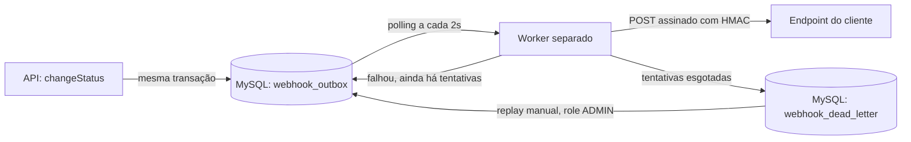

# RFC — Webhooks de notificação de mudança de status de pedido

## Metadados

| Campo | Valor |
| --- | --- |
| Autor | Leticiasg |
| Status | Em revisão |
| Data | 2026-11-25 |
| Revisores | Larissa (Tech Lead), Marcos (Product Manager), Bruno (Engenheiro Pleno, Pedidos), Diego (Engenheiro Sênior, Plataforma), Sofia (Engenheira de Segurança) |
| Origem | Reunião técnica de quinta-feira, 09:00, registrada em `TRANSCRICAO.md` |
| Documentos ligados | [PRD](PRD.md) · [FDD](FDD.md) · [ADRs](adrs/) · [Tracker](TRACKER.md) |

Larissa encerrou a reunião dizendo que ia abrir o documento de design e marcar uma revisão com Bruno e Diego antes de começar a codar ([09:50] Larissa). Este RFC é esse documento: junta o que foi decidido, as alternativas que ficaram pelo caminho e o que ainda não tem resposta.

## Resumo executivo (TL;DR)

O OMS vai avisar os clientes B2B, por webhook, quando o status de um pedido deles mudar. A mudança de status grava o evento numa tabela de outbox no MySQL, na mesma transação do pedido. Um worker separado lê essa tabela a cada 2 segundos e faz a chamada HTTP para o endpoint cadastrado pelo cliente, assinada com HMAC-SHA256 e uma secret própria daquele endpoint. Se a chamada falha, o worker tenta de novo com intervalos crescentes durante cerca de 15 horas e, depois disso, move o evento para uma DLQ que um administrador pode reprocessar. A entrega é at-least-once: o cliente descarta repetições pelo `X-Event-Id`. Tudo segue os padrões que o projeto já usa, sem infraestrutura nova. A estimativa é de três sprints, com revisão de segurança no fim.

## Contexto e problema

Três clientes B2B (Atlas Comercial, MaxDistribuição e Nova Cargo) pediram formalmente para ser avisados quando o status dos pedidos deles muda. Hoje eles consultam `GET /orders` de tempos em tempos, o que deixa a integração lenta e cara do lado deles. A Atlas disse que pode ir para um concorrente se isso não sair até o fim do trimestre ([09:00] Marcos) e pediu a entrega para o fim de novembro ([09:45] Marcos). Para os clientes, qualquer atraso abaixo de 10 segundos conta como tempo real ([09:02] Marcos).

O fluxo é só de saída: o OMS envia, os clientes recebem ([09:02] Marcos, [09:03] Sofia). O código atual não tem nenhum mecanismo de evento, fila ou notificação externa.

A restrição técnica central está no `changeStatus` de `src/modules/orders/order.service.ts`. Ele roda numa transação que atualiza o pedido, grava o histórico e mexe no estoque ([09:04] Bruno). Colocar uma chamada HTTP ali faria um cliente lento travar a mudança de status de outros pedidos, e um cliente fora do ar não tem como desfazer uma mudança que já aconteceu ([09:04] Bruno).

## Proposta técnica

**Registro do evento.** Quando o status de um pedido muda, o `changeStatus` grava o evento na tabela `webhook_outbox` dentro da própria transação. Se o pedido muda, o evento existe; se a transação volta, o evento some junto. O evento só é gravado se algum webhook do customer quer aquele status, e o payload é gravado pronto, como retrato do pedido naquele momento. Ver [ADR-001](adrs/ADR-001-outbox-no-mysql.md).

**Entrega.** Um processo separado da API, com entry point próprio, lê os eventos pendentes mais antigos a cada 2 segundos e faz as chamadas. O polling acrescenta até 2 segundos de atraso, dentro da meta de 10. Nesta fase roda um único worker, e a ordem dos eventos é garantida só por pedido. Ver [ADR-002](adrs/ADR-002-worker-separado-em-polling.md).

**Falhas.** Sem resposta em 10 segundos, ou com erro, a chamada conta como falha. O worker tenta de novo em 1 minuto, 5 minutos, 30 minutos, 2 horas e 12 horas. Esgotadas as tentativas, o evento vai para uma tabela de DLQ, de onde só um ADMIN pode recolocá-lo na fila. Ver [ADR-003](adrs/ADR-003-retry-com-backoff-e-dlq.md).

**Segurança.** Cada endpoint cadastrado tem sua secret, gerada pela plataforma e rotacionável, com 24 horas de convivência entre a antiga e a nova. A URL precisa ser https. Ver [ADR-004](adrs/ADR-004-hmac-sha256-com-secret-por-endpoint.md).

**Garantia de entrega.** O cliente pode receber o mesmo evento mais de uma vez e usa o id do evento para descartar repetições. Ver [ADR-005](adrs/ADR-005-at-least-once-com-x-event-id.md).

**Superfície para o cliente.** Endpoints autenticados para cadastrar, listar, editar e remover webhooks, rotacionar a secret e consultar o histórico de entregas; um endpoint administrativo para o replay da DLQ. Não haverá painel visual nesta fase.

**Encaixe no código.** O webhook vira um módulo como os outros, em `src/modules/webhooks/` (a criar), reaproveitando `AppError`, o error middleware, o logger Pino, os schemas Zod e o `requireRole`. Ver [ADR-006](adrs/ADR-006-reuso-dos-padroes-do-projeto.md).

Contratos, payload, códigos de erro, modelagem das tabelas e observabilidade estão no [FDD](FDD.md).

## Alternativas consideradas

| Alternativa | Por que foi descartada | Trade-off que pesou | Fonte |
| --- | --- | --- | --- |
| Enviar o webhook de forma síncrona dentro do `changeStatus` | Um cliente lento travaria a mudança de status de outros pedidos, e um cliente fora do ar não tem como desfazer a mudança | Simplicidade e entrega imediata contra disponibilidade da operação de pedidos | [09:04] Bruno, [09:06] Diego |
| Fila externa (Redis Streams ou Redis Cluster) | Exigiria subir e operar infraestrutura nova, o que Diego chamou de overengineering para um time pequeno | Fila feita para isso contra custo de operação | [09:07] Larissa, [09:07] Diego |
| Trigger no MySQL para acordar o worker | O MySQL não tem LISTEN/NOTIFY; a trigger não avisa processo externo sem algum improviso | Reação imediata contra uma solução frágil | [09:09] Bruno, [09:09] Diego |
| Retry sem limite, ou só 3 tentativas | Sem limite, o evento fica pendurado para sempre; com 3, desiste em cerca de 30 minutos, antes de uma manutenção de 2 horas terminar | Insistência contra eventos presos; agressividade contra cobertura de quedas longas | [09:15] Diego, [09:16] Bruno, [09:16] Diego |
| Uma secret global da plataforma | Se vaza, expõe todos os clientes | Menos estado para guardar contra raio de um vazamento | [09:21] Sofia |
| Entrega exactly-once | Exigiria coordenação entre os dois lados e muito mais complexidade | Conforto para o cliente contra complexidade da plataforma | [09:25] Diego |

## Questões em aberto

Levantadas na reunião e ainda sem decisão:

1. **Rate limiting de envio por cliente.** Se 50 pedidos de um cliente mudam de status em um minuto, ele recebe 50 chamadas. A reunião decidiu observar e decidir depois, se virar problema ([09:38] Diego, [09:39] Diego, [09:39] Larissa).
2. **Como escalar além de um worker.** Com vários workers a ordem por pedido se perde. Diego citou particionar por `order_id` ou usar lock pessimista, sem escolher ([09:13] Diego).
3. **Onde vai o `customer_id` nas rotas de configuração.** Ficou decidido que ele não vem do JWT, mas não se vai no body ou no path ([09:32] Larissa).
4. **Proteção contra replay attack.** O `X-Timestamp` é enviado para o cliente detectar replay "se quiser" ([09:44] Diego); a reunião não definiu janela de validade nem recomendação para o cliente.

Adiadas para uma fase futura:

5. **Aviso por e-mail quando o webhook do cliente falha.** Fica para uma próxima fase, depois de medir o impacto desta ([09:37] Larissa).
6. **Restringir o CRUD de configuração por role.** Por enquanto qualquer usuário autenticado pode usar; "mais pra frente a gente pode endurecer" ([09:37] Sofia).

Pontos que a reunião não cobriu e que apareceram ao escrever os ADRs, para os revisores decidirem:

7. Durante as 24 horas de rotação, a plataforma assina com a secret antiga, com a nova ou com as duas? ([ADR-004](adrs/ADR-004-hmac-sha256-com-secret-por-endpoint.md))
8. O replay da DLQ mantém o `event_id` original? Se gerar outro, o cliente não consegue deduplicar ([ADR-005](adrs/ADR-005-at-least-once-com-x-event-id.md)).

Os pontos de implementação que também ficaram sem resposta (validação de https, limite de 64KB, regra de sucesso da entrega, entre outros) estão em [Pendências para a revisão](FDD.md#pendências-para-a-revisão), no FDD.

## Impacto e riscos

**No sistema existente.** A transação do `changeStatus` ganha uma escrita a mais, e o módulo de pedidos passa a chamar uma função do módulo de webhooks. O banco recebe consultas do worker a cada 2 segundos e uma tabela que cresce sem limpeza, já que o arquivamento dos eventos entregues ficou fora do escopo ([09:08] Diego). Surge um segundo processo, `npm run worker`, para subir e monitorar.

**Para os clientes.** Eles precisam deduplicar pelo `X-Event-Id` e validar a assinatura. Marcos vai explicar os dois no portal de desenvolvedor ([09:26] Marcos, [09:40] Marcos).

**Riscos técnicos:**

| Risco | Mitigação proposta |
| --- | --- |
| Inserção na outbox falhar e derrubar a mudança de status | É o comportamento escolhido: sem evento, sem mudança ([09:40] Bruno). A integração no `order.service` tem testes ponta a ponta previstos no plano ([09:46] Larissa) |
| Cliente que não deduplica processar o mesmo evento duas vezes | Documentação destacada no portal ([09:26] Marcos) e `X-Event-Id` em todo envio |
| Vazamento de secret | Secret por endpoint, rotação com 24 horas de convivência e revisão de segurança de pelo menos dois dias úteis antes do deploy ([09:21] Sofia, [09:46] Sofia) |
| Rajada de eventos para um mesmo cliente | Sem limite de envio nesta fase; observar e decidir (questão 1) |
| Ordem trocada se alguém subir um segundo worker | Rodar um worker só e tratar a escala como decisão nova (questão 2) |

**Prazo.** Larissa estimou três sprints: outbox e DLQ (uma), worker e retry (uma), CRUD e histórico de entregas (meia), integração no `order.service` e testes ponta a ponta (meia), mais HMAC, schemas e validações, com a revisão de segurança da Sofia no fim ([09:46] Larissa, [09:47] Larissa).

## Decisões relacionadas

- [ADR-001: Registrar os eventos de webhook numa outbox no MySQL](adrs/ADR-001-outbox-no-mysql.md)
- [ADR-002: Entregar os eventos com um worker separado que lê a outbox por polling](adrs/ADR-002-worker-separado-em-polling.md)
- [ADR-003: Retentar com backoff exponencial e mover para uma DLQ em tabela separada](adrs/ADR-003-retry-com-backoff-e-dlq.md)
- [ADR-004: Assinar os webhooks com HMAC-SHA256 e uma secret por endpoint](adrs/ADR-004-hmac-sha256-com-secret-por-endpoint.md)
- [ADR-005: Garantir entrega at-least-once, com deduplicação pelo X-Event-Id](adrs/ADR-005-at-least-once-com-x-event-id.md)
- [ADR-006: Construir o módulo de webhooks com os padrões que o projeto já tem](adrs/ADR-006-reuso-dos-padroes-do-projeto.md)
